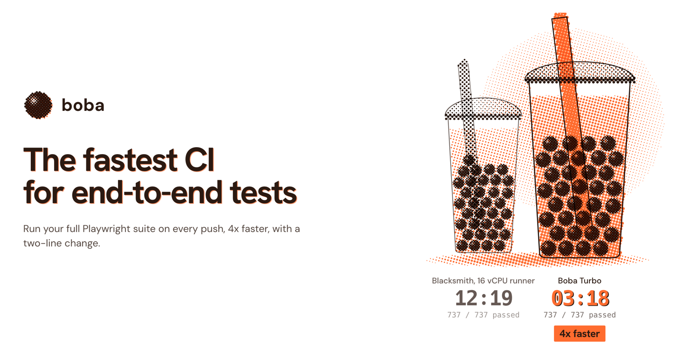
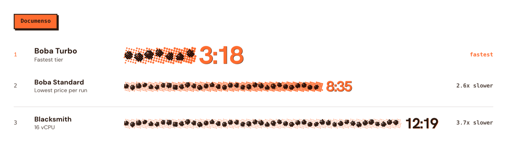
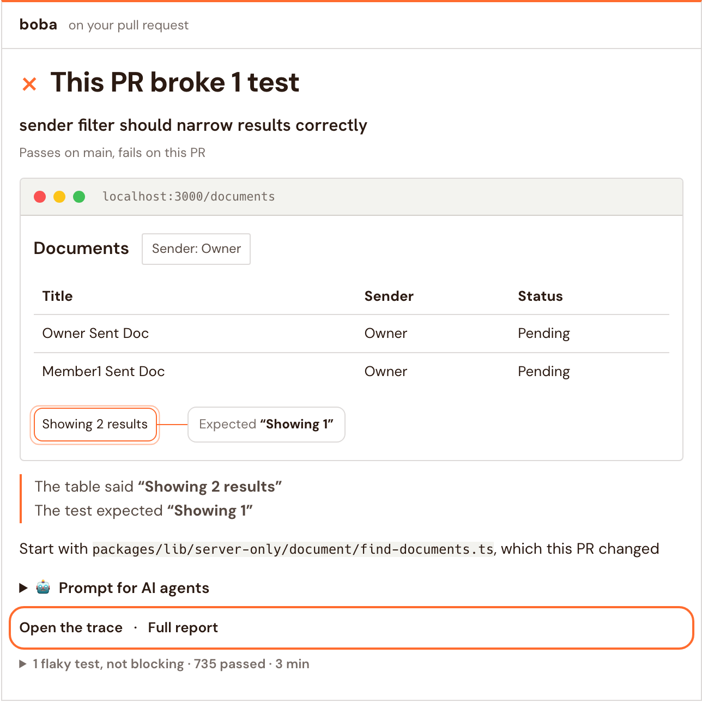

<p align="center">
  <a href="https://www.coldtea.ai/boba"></a>
</p>

<p align="center">
  <a href="https://www.coldtea.ai/boba/install"><b>Add to GitHub</b></a> ·
  <a href="https://www.coldtea.ai/boba/docs">Docs</a> ·
  <a href="https://www.coldtea.ai/boba#benchmark">Benchmark</a> ·
  <a href="https://www.coldtea.ai/boba#pricing">Pricing</a>
</p>

## Switch your workflow in two lines

First, [add Boba to GitHub and add a card](https://www.coldtea.ai/boba/install). Boba doesn't run a job until you've done both.

Then point `runs-on` at Boba and swap your test command for the Boba action. You keep your Playwright config as it is.

```diff
 jobs:
   e2e:
-    runs-on: ubuntu-latest
+    runs-on: coldtea-boba
     steps:
       - uses: actions/checkout@v4
       # ...keep your install, build and app start steps
-      - run: npx playwright test
+      - uses: coldteadotai/boba@v1
```

Boba sets up your app on your first push. That's the only time you wait for setup. From your second push on, Boba starts your tests the moment you push.

## 4x faster

<p align="center">
  
</p>

We ran [Documenso](https://github.com/documenso/documenso)'s 737 end-to-end tests on each runner, with the same commit and the same Playwright flags:

| Runner | Full suite | Cost per run |
| --- | --- | --- |
| **Boba Turbo** | **3:18** | $0.41 |
| **Boba Standard** | **8:35** | $0.14 |
| Blacksmith, 16 vCPU | 12:19 | $0.39 |

Turbo is 4x faster than Blacksmith. Standard ran the suite for about a third of Blacksmith's price. You pay $0.001 per vCPU-minute on both tiers, for the whole job.

## Boba shows you what broke

<p align="center">
  
</p>

You don't dig through CI logs. Boba leaves one check and one comment on the pull request, and your agent reads them as easily as you do.

- **One check on the commit**, named `Boba` unless you set `check-name`. Boba annotates each failing test on the line that failed and groups failures by cause. On a pull request, Boba marks any test that already fails on your default branch, so you don't blame your change for it.
- **A test report with traces.** Anyone with the link can open a public repository's report. For a private repository, you sign in with GitHub, and Boba opens the report if you can read the repository.
- **A "Boba setup" check when your job needs a fix.** If your job left something behind, such as a secret, this check tells you where it is and how to fix it. When it's a secret, Boba treats your next push like a first run.

Look up any check message in [Troubleshooting](https://www.coldtea.ai/boba/docs/troubleshooting) to see what to do.

## Before your first push

- Keep every step before the Playwright step as it is, and keep your Playwright config as it is.
- If your old test step also started your app, an API or a worker in the background, move those commands into their own step just before `coldteadotai/boba@v1`. Boba then starts your tests with them already running. GitHub starts each step in a fresh shell, so write any variable they export to `$GITHUB_ENV`.
- Boba stops a job after 60 minutes, so keep each Boba job under that.

### Keep pull requests from forks on their own runners

If your repository takes pull requests from forks, send them to the `coldtea-boba-outside` label. Boba then never runs fork code on a runner your own branches use:

```yaml
runs-on: ${{ github.event_name == 'pull_request' && github.event.pull_request.head.repo.full_name != github.repository && 'coldtea-boba-outside' || 'coldtea-boba' }}
```

### Cancel a run when you push again

Add this concurrency block, and GitHub cancels a run when you push again to the same branch or pull request. GitHub still runs every commit on your default branch and in a merge queue.

```yaml
concurrency:
  group: boba-${{ github.workflow }}-${{ (github.event_name == 'merge_group' || github.ref == format('refs/heads/{0}', github.event.repository.default_branch)) && github.sha || github.ref }}
  cancel-in-progress: true
```

### Keep your build cache

If your job builds a Next.js app, add this step just before the build. Each push then builds on the last one's cache, and Next.js recompiles only what changed. Boba restores it from the machine's own disk. On a 200-page Next.js app this took the build from 25 s to 10 s.

```yaml
      - uses: actions/cache@v4
        with:
          path: ${{ github.workspace }}/.next/cache
          key: ${{ runner.os }}-nextjs-${{ hashFiles('pnpm-lock.yaml', 'package-lock.json', 'yarn.lock', 'bun.lock') }}-${{ github.sha }}
          restore-keys: |
            ${{ runner.os }}-nextjs-${{ hashFiles('pnpm-lock.yaml', 'package-lock.json', 'yarn.lock', 'bun.lock') }}-
      - run: npm run build
```

- In a monorepo, set `path` to the `.next/cache` folder of each app the job builds.
- Keep the commit in the key. Hashing your source files walks `node_modules` and adds seconds to every run.
- If you build through Turborepo, cache `.turbo/cache` (or the `cacheDir` your `turbo.json` sets) the same way, with `turbo` in place of `nextjs` in both keys.

### Turn on Turbo

```yaml
      - uses: coldteadotai/boba@v1
        with:
          turbo: true
```

Turbo gives you the fastest result. A Turbo run costs about 3x a Standard run. See [Billing](https://www.coldtea.ai/boba/docs/billing).

### Run several Playwright steps in one job

Put them all in one Boba step. List each of the other steps under `suites`, with the config, args and env it used. Boba runs the step's own `config` and `playwright-args` as one more suite, runs every suite, and posts one check with a section for each.

```yaml
      - uses: coldteadotai/boba@v1
        with:
          suites: |
            - name: email
              config: e2e/playwright.config.email.ts
              args: --grep @email
              env:
                E2E_ALLOW_EMAIL_CHANGE: 'false'
```

## Change what the step does

On `runs-on: coldtea-boba` you can leave out every input.

| Input | Default | What it does |
| --- | --- | --- |
| `working-directory` | | Tells Boba which folder holds the suite's `playwright.config`, relative to the checkout. Set it only when your repository has several configs. |
| `config` | | Names your Playwright config file, when you called it something other than `playwright.config`. Pass the same file you pass to `playwright test -c`. |
| `project` | | Picks the Playwright project to run. Leave it empty and Boba runs every project. |
| `playwright-args` | | Adds arguments that Boba passes to `playwright test`. Separate them with spaces. |
| `turbo` | `false` | `true` runs the suite on Turbo, the fastest tier. `false` runs it on Standard, the lowest price per run. |
| `fail-fast` | `true` | On a pull request, Boba stops at the first test that still fails after its retries, and the check tells you how many tests Boba didn't run. Set `false` and Boba runs the whole suite. On pushes and merge queues, Boba always runs the whole suite. |
| `suites` | | Lists the other Playwright steps' runs, as a YAML list, when a job has more than one Playwright step. See [Run several Playwright steps in one job](#run-several-playwright-steps-in-one-job). |
| `timeout-minutes` | `60` | Sets how many minutes the step waits for results. |
| `check-name` | `Boba` | Names the check run. |
| `post` | `true` | Set `false` and Boba prints the check instead of posting it. |
| `job-id` | | Attaches the step to a Boba job that already exists, so Boba doesn't start a new one. |
| `api-url` | | Points the step at Boba. You don't need it on `coldtea-boba`, where the runner knows Boba's address. |
| `api-token`, `secrets`, `github-token` | | You don't need these on `coldtea-boba`. Boba keeps them for workflows that predate Boba's own runners. |

## How Boba protects your data

Boba keeps your secrets out of everything it stores and publishes, withholds any report that shows one, and keeps your data in the EU. Read [what Boba keeps, who can read it and when Boba deletes it](https://www.coldtea.ai/boba/docs/security).

## License

[MIT](LICENSE)
